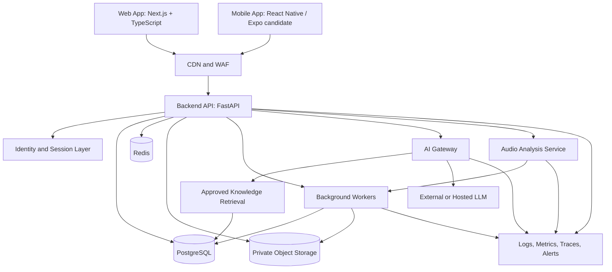

# NadaVerse — System Architecture

**Status:** Proposed reference architecture  
**Approach:** Modular monolith first, with independently scalable workers and AI/audio services where justified by load.

## 1. Architecture goals

- Ship a useful MVP without premature microservices.
- Support web and mobile clients through a versioned API.
- Keep identity, permissions, fair-use controls, and private data under backend control.
- Isolate AI model access, audio analysis, and media storage behind interfaces.
- Maintain provenance and review status for cultural/educational content.
- Make privacy, auditability, observability, and cost management first-class.

## 2. Logical architecture

This is a logical diagram, not a requirement to deploy every box as a separate service. For the first release, the API can be one deployable application, with a separate worker process. Split services only when scaling, security isolation, or team ownership justifies it.

## 3. Recommended stack

### Web
- Next.js + TypeScript.
- Tailwind CSS using design tokens.
- Accessible component primitives.
- Framer Motion only for purposeful transitions.
- Web Audio API for browser playback and low-latency practice interactions.
- Server rendering/static generation for public educational pages where suitable.

### Mobile
- React Native with Expo is a reasonable cross-platform starting point.
- Use native audio capabilities where browser-style APIs are insufficient.
- Share API contracts, design tokens, validation schemas where practical, and domain types—not every UI component.
- Confirm audio latency, background playback, microphone permissions, and offline requirements with a technical spike before locking the mobile stack.

### Backend
- Python + FastAPI.
- Pydantic validation and OpenAPI-generated API documentation.
- SQLAlchemy or SQLModel with Alembic migrations; choose one and standardise.
- PostgreSQL as the system of record.
- Redis for caching, rate-limit support, and job coordination where required.
- Background jobs through a maintained queue/worker library selected after operational review.

### AI and audio
- Internal AI gateway with provider adapters.
- Retrieval from approved, versioned content.
- Embeddings/vector search may use PostgreSQL with pgvector initially; do not add a separate vector database unless scale or retrieval needs warrant it.
- Audio analysis initially runs as a bounded service/worker using Python tooling such as librosa and suitable pitch-detection algorithms.
- Store algorithm version, analysis settings, and confidence/quality metadata with results.
- Do not treat pitch estimates as authoritative raga or swara judgements.

### Infrastructure
- Docker for reproducible development and deployment.
- Managed PostgreSQL and object storage where practical.
- CDN/WAF in front of public web content and API protections as appropriate.
- CI checks, migration validation, dependency scanning, secrets scanning, backups, restore tests, and monitoring.
- Infrastructure as code once the first deployment target is selected.

## 4. Module boundaries

1. **Identity:** users, sessions, verification, account lifecycle.
2. **Profiles and preferences:** display name, language, tonic preference, accessibility settings.
3. **Content catalogue:** ragas, talas, instruments, composers, compositions, glossary, lessons.
4. **Learning:** paths, modules, lessons, completion, bookmarks.
5. **Practice:** sessions, settings, private notes, recording metadata, analysis jobs.
6. **Media:** object references, rights metadata, signed access, retention/deletion.
7. **AI tutor:** conversation orchestration, retrieval, citations, quotas, safety.
8. **Usage and fair-use controls:** transparent abuse prevention and operational usage tracking; no paid-plan entitlements or billing.
9. **Teacher tools (later):** classes, assignments, submissions, feedback.
10. **Administration:** content workflow, moderation, audit.
11. **Notifications:** email/push preferences and delivery records.
12. **Observability:** application metrics, security events, audit events, AI usage and cost.

Keep domain modules separated in code even if they share a database and deployment.

## 5. Core data model

Use UUID/ULID identifiers, UTC timestamps, explicit status fields, and migration-managed schemas. Exact implementation can evolve, but preserve these concepts.

### Identity and SaaS
- `users`: id, email, auth provider reference, status, created_at, deleted_at.
- `user_profiles`: user_id, display_name, locale, preferences JSON with validated schema.
- `roles` / `user_role_assignments`: role definitions and assignments.
- `organizations`: id, name, status (for future teacher/studio/institution collaboration features).
- `organization_memberships`: organization_id, user_id, role.
- `usage_events`: user/organization, feature, units, timestamp, idempotency key. Usage records are for reliability, cost visibility, and fair-use/abuse prevention only—not paid feature gating.

### Content
- `content_items`: id, type, slug, title, summary, language, status, current_revision_id.
- `content_revisions`: content_id, version, body/schema, author_id, reviewer_id, reviewed_at, source metadata.
- `sources`: source type, title, creator/publisher, URL or citation, rights notes, access date.
- `media_assets`: storage key, MIME type, checksum, duration/dimensions, visibility, rights status, retention policy.
- `content_media_links`: content_id, media_asset_id, usage context.
- `ragas`: content_id, canonical name, aliases, parent-raga relationship where verified, notation representation.
- `talas`: content_id, cycle structure, beat/group metadata, supported practice representation.
- `instruments`: content_id, family, materials, technique, regional/lineage notes.
- `composers`, `compositions`, `composition_relationships`: attribution and relationship records; rights must be modelled independently.
- `lessons`, `learning_paths`, `learning_path_items`: sequence and prerequisites.

### Learning and practice
- `learning_enrolments`: user_id, path_id, status, started_at, completed_at.
- `lesson_progress`: user_id, lesson_id, state, completion metadata.
- `bookmarks`: user_id, content_id, created_at.
- `practice_sessions`: user_id, started_at, ended_at, focus, settings snapshot, private notes.
- `recording_assets`: practice_session_id, media_asset_id, consent/retention fields.
- `analysis_jobs`: session/asset, status, algorithm_version, parameters, error code.
- `analysis_results`: job_id, derived features, confidence/quality, limitations, created_at.
- `tutor_conversations` / `tutor_messages`: owner, timestamps, retention/deletion state.
- `tutor_citations`: message_id, content_revision_id, excerpt/location metadata.

### Teacher tools (later)
- `classes`, `class_memberships`, `assignments`, `assignment_items`, `submissions`, `feedback`.

### Audit and governance
- `audit_events`: actor, action, target type/id, timestamp, outcome, safe metadata.
- `consent_records`: subject, purpose, policy version, granted/revoked timestamps.
- `content_rights_records`: asset/content, rights holder, permission scope, territory, expiry, evidence reference.
- `deletion_jobs`: target, status, attempts, completion timestamp.

Avoid storing arbitrary sensitive data in JSON blobs. Define schemas and retention rules for every personal-data field.

## 6. API design

- Use `/api/v1` initially and maintain backward compatibility where reasonable.
- Publish OpenAPI docs for internal and approved external consumers.
- Validate all inputs with Pydantic.
- Use cursor pagination for potentially large lists.
- Standard error envelope with machine-readable error code and safe message.
- Use idempotency keys for retriable writes where duplicate actions are harmful.
- Apply request IDs and correlation IDs across API, worker, AI, and audio jobs.
- Do not expose database models directly as API contracts.

Example endpoint groups:
- `GET /api/v1/search?q=...&types=...`
- `GET /api/v1/content/{slug}`
- `GET /api/v1/ragas/{slug}`
- `GET /api/v1/talas/{slug}`
- `GET /api/v1/instruments/{slug}`
- `GET /api/v1/learning/paths`
- `POST /api/v1/learning/enrolments`
- `PUT /api/v1/learning/progress/{lesson_id}`
- `POST /api/v1/practice/sessions`
- `POST /api/v1/practice/sessions/{id}/recordings` (private upload flow)
- `POST /api/v1/practice/analysis-jobs`
- `POST /api/v1/tutor/messages`
- `GET /api/v1/me/usage`
- `GET /api/v1/me/usage`

Endpoint names are illustrative and must be reconciled with the selected identity and infrastructure providers. Do not implement billing endpoints.

## 7. AI tutor architecture

1. Authenticate the user and check transparent fair-use/abuse limits where applicable.
2. Validate and normalise the request.
3. Detect the topic and retrieve relevant approved content revisions.
4. Apply retrieval filters based on publication status, language, and access permissions.
5. Build a bounded prompt using only necessary context.
6. Invoke the configured model through the AI gateway with timeout and token limits.
7. Validate structured output and citation references.
8. Reject citations that do not resolve to retrieved sources.
9. Store conversation data according to retention settings.
10. Return the answer, citations, and uncertainty/fallback metadata.
11. Record usage and quality signals without logging sensitive content unnecessarily.

### AI guardrails
- Retrieval sources are untrusted data, not instructions.
- Ignore instructions embedded in retrieved content that attempt to change system behaviour.
- Do not let the tutor invoke arbitrary tools or access private assets without explicit authorisation.
- Never claim a raga identification is certain from weak evidence.
- Use “I don't have enough reviewed material to answer confidently” when needed.
- Separate factual content from interpretive commentary.
- Provide a report/correction path for potentially wrong answers.
- Evaluate hallucination, citation correctness, prompt injection, privacy leakage, and cost.

## 8. Audio processing architecture

- Capture audio only after a clear user action and permission.
- Explain whether processing happens on-device or on the server.
- Prefer local processing for simple tuner interactions when feasible.
- For uploads, use short-lived upload URLs, size/type limits, checksum verification, and private object storage.
- Enqueue analysis asynchronously for longer processing.
- Store derived features separately from raw audio.
- Set a documented retention period and support user deletion.
- Do not keep raw recordings longer than necessary.
- Return a status resource for asynchronous jobs.
- Use synthetic signals and consented, rights-cleared test data.
- Treat noisy input, multiple instruments, percussion, room echo, and gamakas as limitations.

## 9. Security and privacy

- Use a reputable identity provider or secure framework; never implement password cryptography from scratch.
- Enforce server-side authorisation at object level.
- Use tenant-scoped queries for organisation data and test cross-tenant access.
- Apply CSRF protections when cookie-based sessions are used.
- Use secure, HttpOnly, SameSite cookies where applicable; mobile token storage must use platform-secure storage.
- Use TLS, managed secrets, rotation, least-privilege service identities, and restricted network access.
- Rate-limit login, tutor requests, uploads, and expensive analysis jobs.
- Validate uploads by size, MIME type, file signature, and safe processing strategy.
- Keep private audio, conversations, and account data out of public caches.
- Redact access tokens, raw audio, and unnecessary personal data from logs.
- Provide export/deletion workflows and define backup deletion limitations transparently.
- Conduct threat modelling before enabling public uploads, payments, or teacher-submitted content.

## 10. Multi-tenancy

Even if MVP starts with individual accounts, model organisational ownership for future teacher/studio collaboration. Every organisation-owned resource must carry an organisation scope. Every access path must verify membership and role. Do not trust a client-supplied `organization_id` without checking membership and resource ownership.

## 11. Observability and operations

Track:
- API latency, error rates, saturation, and availability.
- Worker queue depth, job failures, retries, and processing duration.
- AI latency, model/provider, token usage, cost, citation validity, and fallback rate.
- Audio analysis duration and failure rates.
- Fair-use events, AI usage/cost, and abuse-control monitoring.
- Security events: auth failures, permission denials, suspicious upload activity, admin changes.
- User-impacting errors with privacy-safe context.

Operational requirements:
- Health/readiness checks.
- Backups with tested restore procedures.
- Migration and rollback runbooks.
- Dependency and secret scanning.
- Alert thresholds and on-call ownership before public launch.
- Incident response and user communication procedures.

## 12. Deployment environments

- **Local:** Docker Compose, seeded synthetic data, mock external adapters.
- **CI:** lint, type checks, unit/integration tests, dependency and secret scans, migration validation.
- **Staging:** production-like configuration, test accounts, no real customer data unless governed.
- **Production:** managed secrets, restricted admin access, monitoring, backups, WAF/rate limits, controlled releases and rollback.

Never copy production recordings or customer records into development.

## 13. Architecture decision records (ADRs)

Create an ADR for decisions that materially affect cost, privacy, reliability, or migration:
- Mobile framework and audio capability.
- Authentication/session strategy.
- Object storage and retention.
- Job queue and worker deployment.
- AI provider and model routing.
- Vector retrieval approach.
- Grant/sponsorship governance and transparent funding disclosures.
- Analytics and privacy controls.
- Local/offline audio processing.
- Deployment region and data residency.

## 14. Delivery sequence

1. Repository foundation, CI, design tokens, API skeleton.
2. Content schemas and admin workflow.
3. Public catalogue, search, and lesson path.
4. Shruti player and tala metronome.
5. Identity, saved progress, private practice records.
6. Grounded AI tutor.
7. Mobile shell and core flows.
8. Private recording and analysis jobs.
9. Fair-use controls, cost visibility, and non-paywall funding/operational sustainability.
10. Teacher workflows and advanced analysis only after validation.
