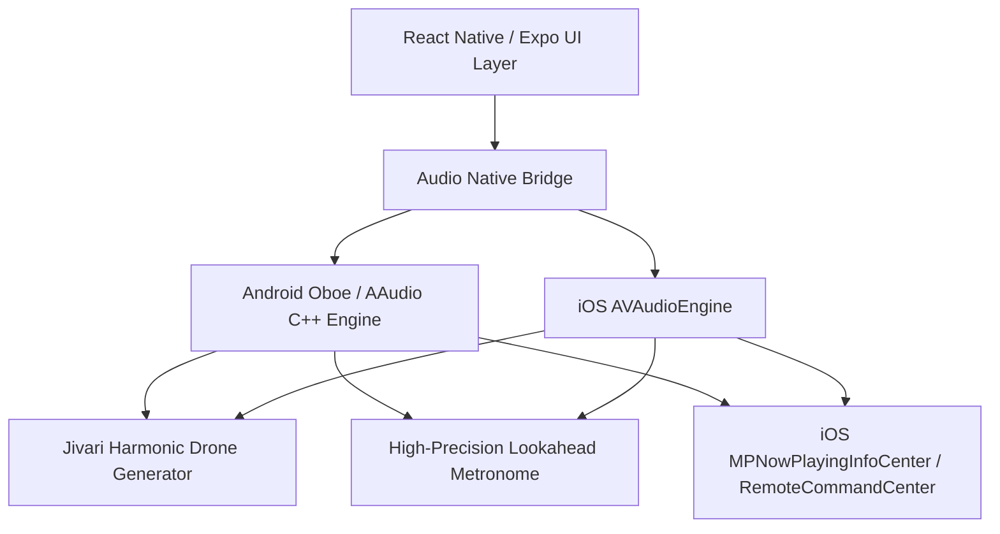

# NadaVerse — Mobile Architectural Readiness & Audio Evaluation

**Document status:** Complete Technical Spike & Architectural Strategy  
**Target Mobile Platforms:** iOS (16+) and Android (12+)  
**Framework Recommendation:** React Native with Expo (Managed Workflow with Custom Native Modules where necessary)

---

## 1. Executive Summary

NadaVerse requires high-precision, low-latency audio for two core capabilities:
1. Continuous background Tanpura drone playback without stuttering or mobile OS suspension.
2. Low-jitter Tala metronome click scheduling synchronized with on-screen visual beats.

This document evaluates the mobile implementation path, audio latency requirements, backgrounding lifecycles, and shared contract reuse with our FastAPI backend.

---

## 2. Audio Engine Evaluation: Mobile Spike

### The Problem with Default Mobile Web Views
In standard mobile browsers (Safari iOS and Chrome Android):
- Background execution is strictly throttled or paused when the device screen locks.
- Web Audio API contexts are suspended automatically to preserve battery.
- Jitter occurs if reliance is placed on JavaScript timers (`setTimeout`/`setInterval`).

### Native Mobile Solution Architecture

### iOS Requirements
- **Audio Session Category:** `AVAudioSessionCategoryPlayback` with `.mixWithOthers` option if users want to play shruti while recording or consulting other tools.
- **Background Mode:** `audio` capability enabled in `Info.plist`.
- **Remote Controls:** Integration with `MPRemoteCommandCenter` for lockscreen Play/Pause and tonic adjustments.

### Android Requirements
- **Foreground Service:** Audio playback must be accompanied by a persistent notification with a `MediaSessionCompat` token.
- **Audio API:** Use `expo-av` for simple playback or native C++ `Oboe` for sub-15ms low-latency synthesis.
- **Battery Optimization:** Request exemption from aggressive vendor battery killers (Samsung, Xiaomi) for extended 2-hour practice sessions.

---

## 3. Shared Assets and API Reusability

Mobile clients will directly consume:
1. **Design Tokens:** `tokens/carnatic-tokens.json` directly drives `StyleSheet` themes in React Native.
2. **API Schema Contracts:** OpenAPI `/docs` specification generated automatically by FastAPI.
3. **Verified Offline Database:** Seed SQLite bundle containing verified Ragas, Talas, and Instruments for offline practice in remote performance halls or retreats without mobile data.
4. **Authentication:** Secure storage using `expo-secure-store` (Keychain on iOS and EncryptedSharedPreferences on Android).

---

## 4. Microphone & Pitch Tuner Mobile Strategy

- Request microphone permission using `expo-av` or `react-native-live-audio-stream` only when user explicitly toggles the pitch tuner.
- Use on-device native FFT / YIN pitch estimation to preserve battery life and guarantee user privacy.
- Raw microphone buffers are never recorded to disk or streamed to external servers.
